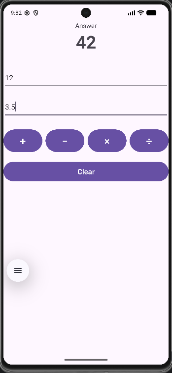

# Calculator

A clean, tested four-operation calculator for Android. Enter two numbers, tap an operator, and get a correctly formatted answer, with friendly handling of bad input and division by zero.

## Features

- **Four operations** — add, subtract, multiply and divide, including decimals and negative numbers.
- **Clean output** — results drop trailing zeros and floating-point noise (`0.1 + 0.2` shows `0.3`, not `0.30000000000000004`).
- **Input validation** — empty fields and invalid numbers show a clear message instead of crashing.
- **Divide-by-zero protection** — handled with an explicit exception in the logic layer and a readable message in the UI.
- **Clear button** — resets both fields and the answer in one tap.
- **Edge-to-edge layout** — respects system bars on modern Android.

## Design

The calculation logic lives in `CalculatorLogic.java`, which has no Android dependencies. This keeps the maths separate from the UI and lets it be unit-tested on the JVM in milliseconds, with no emulator.

```
app/src/main/java/com/example/calculator/
├── MainActivity.java      — UI wiring, input parsing, error messages
└── CalculatorLogic.java   — add / subtract / multiply / divide / format

app/src/test/java/com/example/calculator/
└── CalculatorLogicTest.java — 14 unit tests
```

## Testing

14 JUnit tests cover each operation, negative numbers, decimals, divide-by-zero, and the output formatter (trailing zeros, floating-point noise, large numbers, infinity).

Run them from Android Studio (right-click `CalculatorLogicTest` → Run) or with:

```
./gradlew test
```

## Screenshots

<table>
  <tr>
    <td></td>
    <td></td>
  </tr>
</table>

## Tech Stack

- Java 11, Android SDK 36 (min SDK 24)
- Material 3 theme, AndroidX AppCompat
- JUnit 4
- Gradle Kotlin DSL

## Build & Run

1. Open the project in Android Studio.
2. Let Gradle sync.
3. Run on an emulator or device.

## Author

Lethabo Mashia — BSc IT (Software Engineering), Eduvos
